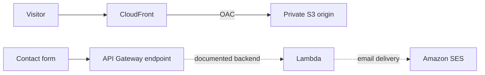

# Kefas Etiku Francis - Engineering Portfolio and AWS Hosting

A buildless HTML/CSS/JavaScript portfolio with a coordinated web resume, 13 project case studies, a filterable project directory and a one-page ATS PDF. The CV leads with practical Cloud/DevOps work and includes a separate AI section.

[Visit kefas.live](https://kefas.live/) · [Web resume](https://kefas.live/resume.html) · [Download resume](https://kefas.live/resume.pdf)

This repository contains one current portfolio at its root. Earlier duplicate folders and obsolete resume files have been removed from the current tree; previous versions remain available in Git history.

## AWS architecture

The documented hosting design uses CloudFront with a private S3 origin, OAC, Route 53 and ACM. The current client sends contact requests to an API Gateway endpoint; it no longer references a Lambda Function URL directly. Lambda/SES email handling, IAM policies, alarms and budgets are backend configuration and are not provisioned by this repository.



The endpoint's CORS preflight for `https://kefas.live` was verified. Current backend delivery, IAM, monitoring configuration and availability metrics have not been independently verified. No production uptime, cost-saving or performance guarantee is claimed.

## Preview

From this folder:

```powershell
python -m http.server 8765 --bind 127.0.0.1
```

Open http://127.0.0.1:8765. The contact endpoint permits the production origin; local-preview submissions may be rejected by CORS. Use direct email for real contact. The browser test suite intercepts contact requests and never sends email.

## Content and generation

Edit `content.json` for identity, resume facts, skills and project evidence. `featured_project_ids` selects the six homepage projects; `resume_sections` selects the Cloud/DevOps and AI groups for the ATS PDF; `resume_web_extras` adds further labs and software work to the web resume. Reordering project cards cannot silently remove projects from the CV. The internship title remains **DevOps & Cloud Engineer Intern**, at **Build and Ship Academy Ltd | Remote**.

NovaMart is a private-source project: the public portfolio contains a high-level case study and no private repository link, code, resource identifiers or operational screenshots. Project status distinguishes source implementations, deployed demos and documentation-backed labs. `docs/PROJECT_STRATEGY.md` ranks the evidence and proposes stronger next projects without presenting them as completed work.

`tools/build.py` is a small build entry point. The maintained sources are organized by responsibility:

| Change | Edit |
| --- | --- |
| Homepage sections | `templates/home/` |
| Shared navigation, project cards, experience rows and resume entries | `templates/` and `tools/components.py` |
| Page assembly and content mapping | `tools/pages.py` |
| Theme tokens, shared styles and section layouts | `css/00-tokens.css` through `css/11-communities.css` |
| Navigation, themes, filters, architecture or contact behavior | The matching file in `js/` |
| Shared browser helpers | `js/core.js` |
| Page initialization | `script.js` |
| ATS PDF layout | `tools/resume_pdf.py` |
| Hero headshot and frame | `headshot/kefas-headshot.png`, `templates/home/home.html`, `css/03-hero.css` |

The hero uses the supplied portrait with intrinsic dimensions and high fetch priority. `tools/portrait_assets.py` builds responsive WebP copies, preserving the PNG as a fallback. Its frame remains visible on mobile and tablet. AOS 2.3.4 is pinned under `assets/vendor/aos-2.3.4/` with its MIT license and loads on generated HTML pages; `js/animations.js` handles reduced motion and failure fallback. No CDN is required. The public packager includes both `headshot/` and the vendored assets, preserving exact lowercase paths for S3. See `docs/HEADSHOT_INTEGRATION.md` for local checks and editing instructions.

Each feature initializer ignores pages without its controls, so the same scripts can be reused across the portfolio, resume and case studies. All feature scripts use one `window.Portfolio` namespace and deferred loading in a declared order. This preserves local-file preview support without JavaScript module/CORS requirements.

HTML templates use named `${slots}` and optional `<!-- include: home/section.html -->` partials. Plain content is escaped by shared rendering helpers. Missing template values fail the build. Comments explain component boundaries, accessibility behavior and error handling.

Rebuild after editing templates, content or CSS sources. The build produces readable `index.html`, `resume.html`, case studies, sitemap, both PDF copies and one combined `styles.css`. This keeps the CSS to one browser request while retaining smaller editable source files. Direct changes to generated HTML or `styles.css` will be replaced by the next build. The PDF condenses the same facts for one page; the web resume provides fuller evidence labels.

```powershell
python -m pip install -r tools/requirements.txt
python tools/assets.py
python tools/build.py
python tests/validate.py
node --check script.js
node --check theme.js
```

Generation uses ReportLab, Pillow and pypdf. Original SVG diagrams are generated from software architecture descriptions; no stock imagery or institutional screenshots are used. Assets contain no runtime external dependencies. `assets/og-image.png` is 1200×630.

To run browser regression checks with an installed Edge browser and Playwright on Node's module path:

```powershell
node tests/browser.cjs
```

Start the local server first. `PORTFOLIO_TEST_URL` can override its origin. Test artifacts are written to `.artifacts/tests/`, which Git ignores.

Optional automated accessibility and Lighthouse audits use QA packages outside the website:

```powershell
npm install --prefix ../qa --no-audit --no-fund lighthouse axe-core playwright
```

Set `NODE_PATH` to the installed Playwright module directory, then run `node tests/audit.cjs`. `PORTFOLIO_QA_DIR` can override the QA `node_modules` path. The recorded run used Lighthouse 13.6.0, axe-core 4.14.0 and installed Edge. Reproduce with the same versions and lockfile for direct comparisons; score variation is expected across machines.

## Files to deploy after a separate release decision

Run `python tools/package_site.py` after building. It creates an allowlisted `public-dist/` directory containing the HTML, PDF, stylesheet, scripts, sitemap, robots file and the `js/`, `assets/` and `case-studies/` directories. Use an empty output directory for each run. Source templates, documentation, tests and credentials are excluded from the deployment package.

The GitHub Actions workflow validates pull requests. A push or merge to `main` also syncs the complete public package to S3, using the existing `AWS_ACCESS_KEY_ID`, `AWS_SECRET_ACCESS_KEY` and `S3_BUCKET_NAME` repository secrets. It no longer uploads only index.html. It does not delete existing S3 objects or perform a CloudFront invalidation; cached content may require the existing CDN refresh process. Opening a pull request does not deploy the website.

## Behavior and accessibility

- Shared 860px desktop/mobile navigation breakpoint; Escape closes the menu and restores focus.
- Static HTML includes all primary content; no reveal gate or typing loop. Navigation remains usable without JavaScript.
- Theme storage failures do not break the site. Light/dark theme tokens, visible focus and reduced-motion support.
- Project filters use `aria-pressed`; the illustrative architecture supports Tab, arrows, Home/End, Enter and touch.
- Contact validation, associated errors, status announcements, bounded fields, honeypot, duplicate-request guard and 12-second timeout. These client controls do not replace backend validation or spam mitigation.
- Separate A4 ATS PDF with selectable text and logical extraction order; web print CSS is also single-column.

Read `docs/PORTFOLIO_AUDIT.md`, `docs/CONTENT_VERIFICATION.md`, `docs/IMPLEMENTATION_SUMMARY.md` and `docs/TEST_RESULTS.md` for evidence, measured results and outstanding limits.

## Redesign audit and credentials

See docs/REDESIGN_AUDIT.md for the requirement-by-requirement assessment and measured results. Section reveals use a shared progressive AOS initializer; project filters refresh the reveal positions. Cards offer hover/focus states, capabilities have local SVG icons, and the experience/education timeline uses the same source facts as the resume. The architecture explorer has delivery-pipeline and AWS-portfolio views. The shared header portrait uses page-relative paths on all 16 HTML pages.

`content.json` contains a `certifications` list. Only complete records with `confirmed: true`, exact `name`, `issuer`, `date`, `kind`, `recipient` and a public HTTPS `verification_url` are rendered as credentials. Six owner-supplied Credly records were verified and populated during the audit; unresolved issuer records are excluded. An empty collection displays an honest pending state. See docs/CREDENTIAL_VERIFICATION.md. Credential rendering tests use fixtures; fixtures never enter the public website.

After creating a public ZIP, run `python tools/verify_site_zip.py PATH_TO_ZIP` to check its allowlist, source bytes, integrity, and exact-case local paths (including srcset and fragment links). A passing local audit does not confirm production deployment or third-party demo availability.


## Technical community involvement

Community membership is stored in the `communities` collection in content.json and rendered by tools/components.py through templates/community-card.html and templates/home/communities.html. The section sits directly after Experience & Education; it does not add an employment or leadership entry to the resume. css/11-communities.css and the shared AOS initializer provide responsive presentation and reduced-motion behavior. See docs/COMMUNITY_UPDATE.md for this change and its verification.
